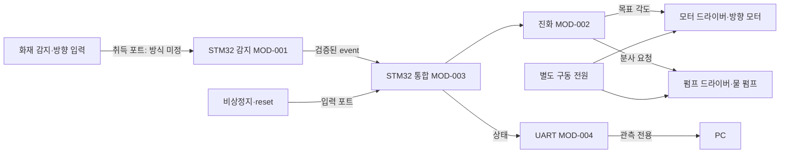

# SW 설계서

프로젝트: 조기 화재 진압 시스템 / 4인(실명 미정) / v0.1 초안 / 2026-10-27.
참고 양식: 사용자 제공 `02_SW_설계서.pdf`. 요구사항 기준: 01-system-requirements.md v0.1. 검토자·기준 tag: 팀 검토 후 기록.

## 1. 설계 기준

공통 C99 로직을 HAL과 분리합니다. PC는 CMake/Ninja, MCU는 STM32CubeIDE + STM32CubeF4 HAL, bare-metal main loop를 1차 계획으로 합니다. RTOS 도입은 현재 범위에 없습니다.
로컬 확인 도구: CubeIDE 1.19.0 설치, GCC(host) 16.1.0, CMake 4.4.1, Ninja 1.13.2, Arm GNU 13.3.Rel1. 이는 권장 최신 버전 선언이 아닌 작업 환경 기록입니다. 팀 기준 IDE/HAL/CubeMX 버전은 보드 프로젝트 생성 PR에서 고정합니다.

## 2. 시스템 구성

센서 취득 → 유효성/취득 시각/각도 검증 → 연속 감지 확인 → 오류 우선순위 평가 → 상태 전이 → 출력 요청 → 하드웨어 포트 적용 순서입니다. 판단과 제어는 MCU에서 수행하며 PC 없이 동작하도록 설계합니다.

## 3. 하드웨어·Peripheral

모델·핀·CN 위치·AF·전압은 [부품·배선표](hardware.md)에 모두 미정으로 표시했습니다. 임의 핀맵은 사용하지 않습니다.
UART(로그), 센서 입력(방식 미정), 타이머(주기/선택한 모터 제어), 비상정지 GPIO가 설계 후보입니다. IRQ/DMA 배치는 취득·통신 지연을 실측해 확정합니다.
전원·드라이버·출력 극성·부팅 OFF·접지/절연은 실제 부품 데이터시트로 확정합니다. CubeIDE `.ioc`와 실제 배선을 함께 검토합니다.

## 4. 통신 규약

[interfaces.md](interfaces.md)의 UART 제안 규약을 따릅니다. 일방향 STM32 → PC 관측이며 PC에서 펌프 ON 명령을 받지 않습니다. 센서가 I2C/SPI/UART 장치로 결정되면 주소·프레임·단위·바이트 순서·주기·timeout·검증·재시도·실패 상위 동작을 별도 절에 추가합니다. AP 보드는 현재 계획에 없습니다.

## 5. 모듈과 실행 흐름

| MOD | 책임·입출력 | 주요 파일 | 연결·담당 | 구현 상태 |
| --- | --- | --- | --- | --- |
| MOD-001 감지 | sample → error/event, 연속성 검증 | detection.c/.h | FR-001~003, 감지 B | PC 공통 구현 |
| MOD-002 진화 | event → 상태·각도·펌프 요청 | suppression.c/.h | FR-004/005, 진화 A/B | PC 공통 구현 |
| MOD-003 통합 | 오류 래치, 비상정지·reset, 감지→진화 호출 | fire_system.c/.h | FR-006/007, 공동 | PC 공통 구현 |
| MOD-004 로그 | 상태 → UART 프레임 | 향후 platform/stm32 | FR-008, 감지 A | 규약만 정의 |
| MOD-005 보드 포트 | 센서/GPIO/TIM/출력 드라이버 | platform/stm32/fire_port.h | FR-001/003~007, 감지 A·진화 A/B | 계약만 정의 |

sample은 센서 포트가 소유하고 main loop가 일관된 스냅샷으로 읽습니다. detector와 suppression의 상태는 fire_system_t 한 인스턴스가 소유합니다. 출력 요청은 그 tick에서 소비하며 HAL 핸들을 공통 계층에 전달하지 않습니다.

초기화: 하드웨어 출력 OFF 확보 → HAL/클록/드라이버 초기화 → fire_system_init → 센서 스냅샷 취득 → 주기 step → 출력 포트 적용. 초기화 실패 시 OFF 유지, 보드 오류 래치. 실제 IO 실패 경로는 포트 구현 전 완료해야 합니다.
실행 계획: main loop 10ms, 센서 50ms, UART 100ms/상태 변경. ISR은 수집 완료 통지와 버퍼 인계만 수행합니다. ISR 내 delay/출력 상태 전이/블로킹 UART를 두지 않습니다. 공유 데이터 보호 방법은 포트 PR에서 결정합니다.

| 현재 상태 | 조건 | 다음 상태 | 출력 |
| --- | --- | --- | --- |
| IDLE | 연속 감지 + 유효 방향 | AIMING | 모터 요청, 펌프 OFF |
| AIMING | 감지 해제 | IDLE | 모두 OFF |
| AIMING | 목표 변경 | AIMING, 대기시간 재시작 | 새 각도, 펌프 OFF |
| AIMING | 목표 유지 500ms 경과 | SPRAYING | 모터 요청, 펌프 ON |
| SPRAYING | 감지 해제 또는 3000ms 경과 | COOLDOWN | 모두 OFF |
| SPRAYING | 목표 변경 | AIMING | 펌프 OFF, 재조준 |
| COOLDOWN | 5000ms 경과 | IDLE | OFF, 감지 유지 시 다음 tick 재조준 가능 |
| 모든 상태 | 비상정지 | ESTOP 래치 | 모두 OFF |
| 정상 상태 | 센서/시간/각도/설정 오류 | FAULT 래치 | 모두 OFF |
| FAULT/ESTOP | 정상·신선 입력 + 비상 해제 + 수동 reset + 유효 설정 | IDLE | OFF |

우선순위: 비상정지 → 잘못된 설정 → 기존 래치 → 센서/시간/각도 오류 → 상태 전이. 목표 변경과 최대 분사시간 경과가 동시에 발생하면 COOLDOWN이 우선합니다.

## 6. API와 오류 처리

API-001~005의 원형·단위·포인터·호출 시점·동시성·부작용은 [공통 인터페이스](interfaces.md)를 따릅니다. 모든 공통 함수는 비차단·단일 호출자이며 IO 재시도는 하지 않습니다.

| 오류 | 조건·검출 | 동작·복구 | TC |
| --- | --- | --- | --- |
| ERR-001 SENSOR | NULL sample 또는 valid=false | FAULT, 출력 OFF. 정상 입력 + reset | 008,013,017,102 |
| ERR-002 STALE | age >250ms, 미래·역순 | FAULT, 출력 OFF. 신선 입력 + reset | 009,017,019,102 |
| ERR-003 TARGET | 유효 각도 범위 밖, 확정 감지에 방향 없음 | FAULT, 출력 OFF. 정상 입력 + reset | 010,011,103 |
| ERR-004 CONFIG | 확인 횟수 0, 기간 0 또는 >=2^31ms | FAULT, 출력 OFF. 유효 설정으로 개발자가 재초기화 | 016 |
| ERR-005 ESTOP | 비상정지 입력 true | ESTOP 래치. 비상 해제 + 정상·신선 입력 + reset | 012,013,105 |

보드 출력 쓰기 실패, 통신 장애, 모터 걸림·펌프 공회전 검출은 현재 구현하지 않았습니다. 포트 설계에서 검출 가능 여부와 ERR/FR/TC를 추가합니다. 공통 소프트웨어 출력 OFF만으로 실제 전원 차단을 보증하지 않습니다.

## 7. 설계 판단·변경 이력

| 결정 | 이유·제약 | 추적 |
| --- | --- | --- |
| HAL 없는 공통 C | 두 팀 병렬 개발과 PC 시험, 실제 MCU 빌드는 별도 필요 | 전체 MOD, PC TC |
| 단일 main loop | 공유 상태와 통합 복잡도 제한, 지연은 실측 필요 | NFR-002, TC-108 |
| uint32_t elapsed 비교 | tick wrap 지원, 비교 간격 2^31ms 미만 계약 | FR-007, TC-015 |
| 시간 기반 조준 초안 | 부품 선정 전 최소 흐름, 위치 피드백이나 실측으로 보완 필요 | FR-004, TC-103 |
| 자동 반복은 쿨다운 후 허용 | 지속 감지 대응, 총 반복/물 부족 정책은 미정 | FR-005, TC-104 |

v0.1 / 2026-10-27: 공통 구조·API·상태·오류 초안 작성(Codex), 팀 검토 전. 향후 부품·핀맵·주기 변경 시 영향받는 FR/MOD/TC와 함께 기록합니다.
